# ESP Control Deck

A 2.8-inch touch deck for your desk. It shows your PC at a glance, runs macros, answers Claude Code permission prompts, collects iPhone and Windows notifications, tracks markets and weather, and reminds you to stand up. The hardware is a low-cost ESP32-2432S028 board; a small Python bridge on the PC does the rest.

<p align="center">
  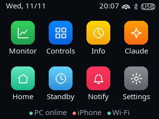
  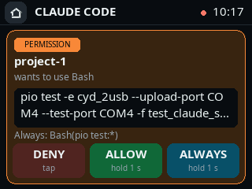
  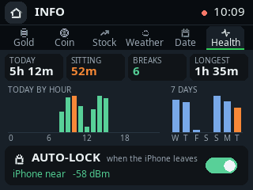
</p>

## Screens

| | | |
| :---: | :---: | :---: |
| 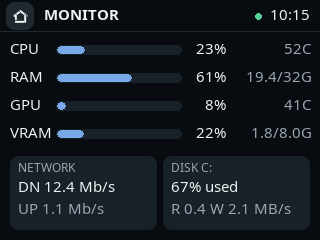<br>**Monitor** — CPU, RAM, GPU, VRAM, network, disk | 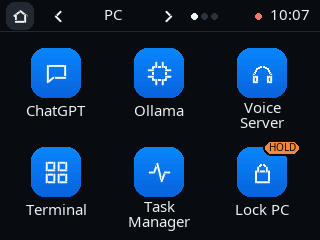<br>**Controls** — 18 macros on 3 pages | 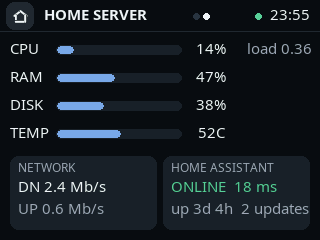<br>**Home server** — your Home Assistant machine |
| 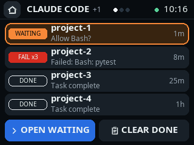<br>**Claude Code** — every session at a glance | 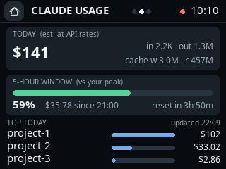<br>**Usage** — tokens, estimated cost, 5-hour window | 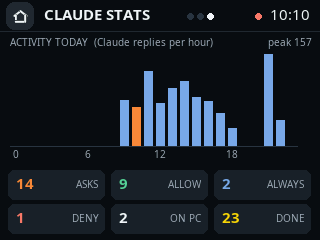<br>**Stats** — replies per hour, answers today |
| 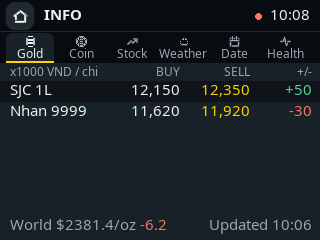<br>**Gold** — Vietnamese gold prices | 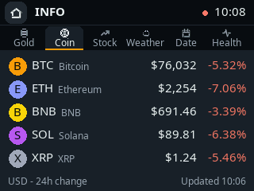<br>**Coin** — crypto prices, 24 h change | 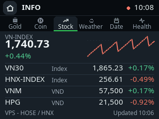<br>**Stock** — VN-Index sparkline and watchlist |
| 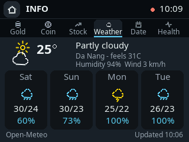<br>**Weather** — now and next 4 days | 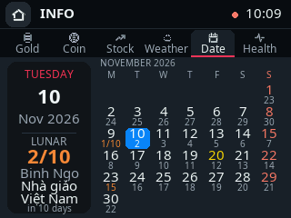<br>**Date** — lunar calendar and holidays | 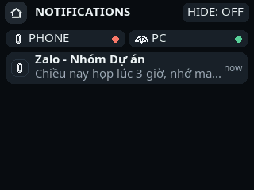<br>**Notifications** — iPhone and Windows |
| 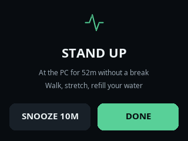<br>**Stand up** — after 50 minutes sitting | 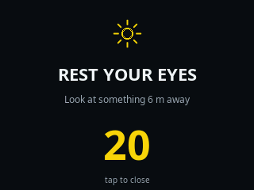<br>**Rest your eyes** — every 20 minutes | 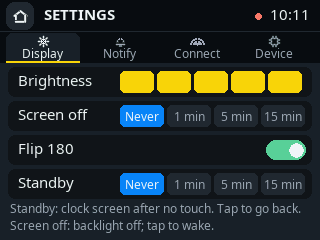<br>**Settings** — display, notifications, links |

## Features

**PC at a glance.** CPU, RAM, GPU and VRAM load with temperatures (LibreHardwareMonitor on Windows), network speed and disk activity, refreshed every 2 seconds. The RGB LED shows the link: green live, blue waiting, red stale.

**Home server.** Swipe the Monitor screen to see the machine that runs Home Assistant: CPU, RAM, disk, temperature, network, uptime, pending updates and whether Home Assistant answers. See [docs/HOME_SERVER.md](docs/HOME_SERVER.md).

**Macros.** 18 buttons on 3 pages, each with an icon and a colour. Launch apps, open URLs, send key combos, run commands, start Ollama. Risky ones (Lock PC) need a 1-second hold. The deck only sends a button number; the actions live in `host/config.json` on your PC.

**Claude Code.** Hooks report every session: waiting (LED blinks orange), running with the current tool, done, or failing three times in a row. A permission prompt opens a card on the deck: tap DENY, hold ALLOW or ALWAYS for one second. If you do not answer within 25 seconds, Claude Code asks on the PC as usual. Two more tabs show today's tokens, the cost at API rates, the current 5-hour window against your own peak, top projects and replies per hour. See [docs/CLAUDE_CODE.md](docs/CLAUDE_CODE.md).

**Notifications.** iPhone notifications over Bluetooth (Apple ANCS) and Windows toasts (Teams, Outlook, Zalo, Phone Link, ...) over Wi-Fi. Vietnamese text keeps its diacritics. Per-app filters, quiet hours, and a switch that hides message text.

**Info.** Vietnamese gold prices, crypto (CoinGecko), the Vietnamese stock market (VN-Index, VN30, HNX and your watchlist), weather (Open-Meteo), and a month calendar with lunar dates and Vietnamese holidays, all computed or fetched by the bridge with no API keys.

**Health.** Minutes at the PC per hour and for the last 7 days, the current sitting session, breaks and a late-night warning. A STAND UP card after 50 minutes without a break and a 20-second REST YOUR EYES card every 20 minutes. See [docs/HEALTH.md](docs/HEALTH.md).

**Auto-lock.** The deck watches the Bluetooth signal of your paired iPhone. When the phone leaves and nobody touches the PC, Windows locks.

**Standby clock.** After a while without a touch the deck turns into a large clock with the date, lunar date, upcoming holiday and weather.

**ARAM screen.** During a League of Legends ARAM game, a companion app on the PC sends the champion, augment offers and item suggestions; the deck opens a dedicated screen and goes back when the game ends.

**USB or Wi-Fi.** With a data cable the deck talks over USB. Without one, power it from any 5 V charger and it links to the bridge over your Wi-Fi with signed packets (about 60 ms round trip). See [docs/WIFI_LINK.md](docs/WIFI_LINK.md).

## Hardware

| | |
| --- | --- |
| Board | ESP32-2432S028 "Cheap Yellow Display", the version with USB-C and micro-USB |
| Screen | 2.8-inch 320x240 ST7789, XPT2046 resistive touch |
| Extras used | RGB LED, Wi-Fi, Bluetooth LE |
| PlatformIO environment | `cyd_2usb` |

A second environment, `esp32_pc_control_deck`, builds the simpler monitor + macros layout for 2.8-inch ILI9341 ESP32 boards. Pinouts are in [docs/HARDWARE.md](docs/HARDWARE.md).

## Quick start

### 1. Flash the deck

```bash
pio run -e cyd_2usb -t upload --upload-port COM4
```

Use your board's port. Stop the bridge first; it keeps the serial port open.

### 2. Start the bridge

Windows:

```text
host\run_windows.bat
```

The first run creates `host/.venv`, installs the dependencies, copies `host/config.example.json` to `host/config.json` and starts the bridge. macOS and Linux: `sh host/run_linux_macos.sh` (see [docs/LINUX_MACOS.md](docs/LINUX_MACOS.md)).

If more than one USB-serial device is plugged in, set the port in `host/config.json`:

```json
"serial_port": "COM4"
```

### 3. Set up `host/config.json`

`host/config.json` is git-ignored and holds everything personal. The main sections:

| Section | What it does | Details |
| --- | --- | --- |
| `macros` | The 18 buttons: label, icon, colour, action | [docs/MACROS.md](docs/MACROS.md) |
| `wifi`, `notifications` | Wi-Fi for the deck and the shared token (generated on first run) | below |
| `coins`, `stocks`, `weather`, `gold` | What the Info tabs show | `config.example.json` |
| `claude` | Claude Code relay, answer timeout, usage tab | [docs/CLAUDE_CODE.md](docs/CLAUDE_CODE.md) |
| `home_server` | Home Assistant address and token for the HOME SERVER tab | [docs/HOME_SERVER.md](docs/HOME_SERVER.md) |
| `activity` | Reminders and auto-lock | [docs/HEALTH.md](docs/HEALTH.md) |
| `wifi_link` | Wi-Fi link when USB is unplugged | [docs/WIFI_LINK.md](docs/WIFI_LINK.md) |
| `librehardwaremonitor` | Extra temperatures from LibreHardwareMonitor | [docs/TEMPERATURES.md](docs/TEMPERATURES.md) |

Wi-Fi and PC notifications:

```json
"wifi": {"ssid": "<your network>", "password": "<your password>"},
"notifications": {"enabled": true, "udp_port": 4210, "token": ""}
```

The bridge sends the Wi-Fi settings and the token to the deck over USB once; the deck keeps them in its own flash.

### 4. Pair your iPhone

On the iPhone open **Settings > Bluetooth**, tap **ESP32 Deck**, accept the pairing and allow notifications. The iPhone reconnects by itself when it is in range.

### 5. Claude Code (optional)

```powershell
host\.venv\Scripts\python.exe host\install_claude_hooks.py
```

Adds the deck's hooks to `~/.claude/settings.json` (a backup is written first). Restart your Claude Code sessions.

### 6. Start with Windows (optional)

```powershell
powershell -ExecutionPolicy Bypass -File .\host\install_autostart_windows.ps1
```

`host\uninstall_autostart_windows.ps1` removes it again.

## Documentation

| | |
| --- | --- |
| [CLAUDE_CODE.md](docs/CLAUDE_CODE.md) | Session status, permission prompts, usage and stats |
| [HOME_SERVER.md](docs/HOME_SERVER.md) | Home Assistant server on the Monitor screen |
| [HEALTH.md](docs/HEALTH.md) | Time at the PC, break reminders, auto-lock |
| [WIFI_LINK.md](docs/WIFI_LINK.md) | Running the deck without a USB data cable |
| [MACROS.md](docs/MACROS.md) | Button actions, icons and colours |
| [TEMPERATURES.md](docs/TEMPERATURES.md) | CPU and GPU temperatures on Windows |
| [LINUX_MACOS.md](docs/LINUX_MACOS.md) | The bridge on Linux and macOS |
| [HARDWARE.md](docs/HARDWARE.md) | Boards and pinouts |
| [PROTOCOL.md](docs/PROTOCOL.md) | Every frame between the bridge and the deck |
| [CHANGELOG.md](CHANGELOG.md) | What changed |

## Privacy and security

- Everything stays on your PC and your local network. The bridge listens on localhost (Claude Code relay) and on your LAN only for the deck's signed packets.
- The deck stores no passwords or accounts besides the Wi-Fi credentials you give it over USB. It keeps notifications in RAM only (newest 10, cleared on reboot).
- The deck sends a button number, never a command; the bridge only runs actions from your local `host/config.json`.
- Claude Code hooks forward the session, tool and a short target (command, file name), never prompts, transcripts or file contents. Usage counts read only token numbers from Claude Code's local logs.
- Personal data stays in git-ignored files: `host/config.json`, `host/device_state.json`, `host/claude_stats.json`, `host/activity_state.json`.

More in [SECURITY.md](SECURITY.md).

## Development

```bash
host/.venv/Scripts/python.exe -m pytest host/tests      # bridge
pio test -e cyd_2usb --upload-port COM4 --test-port COM4 # firmware, on the board
pio run -e esp32_pc_control_deck                         # second board still builds
```

`tools/deck_screenshot.py` captures screens from a connected deck with made-up sample data (it produced the images above).

## License

MIT. See [LICENSE](LICENSE).
